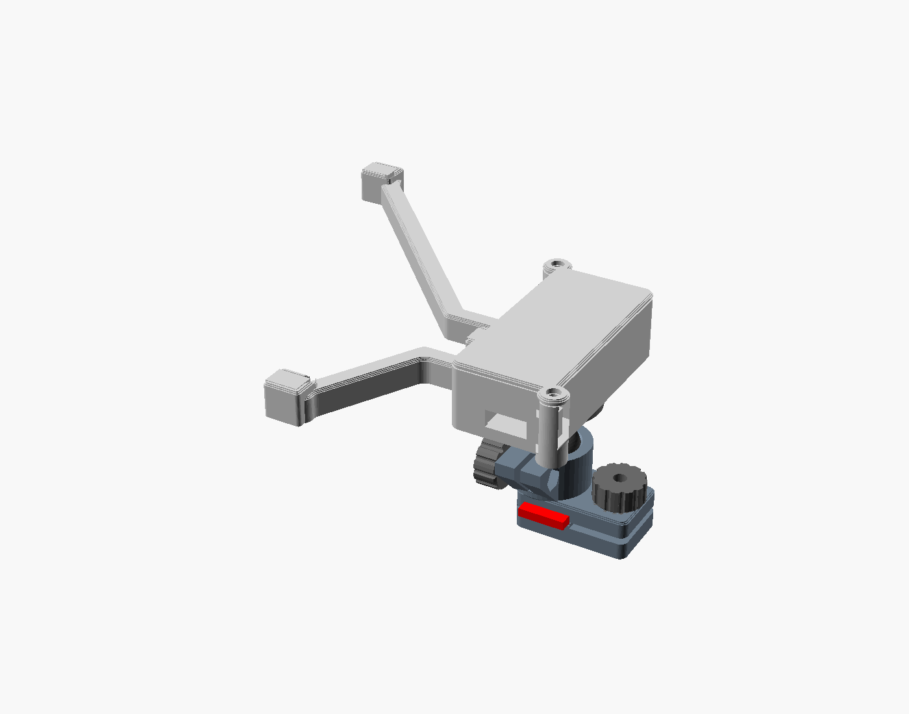
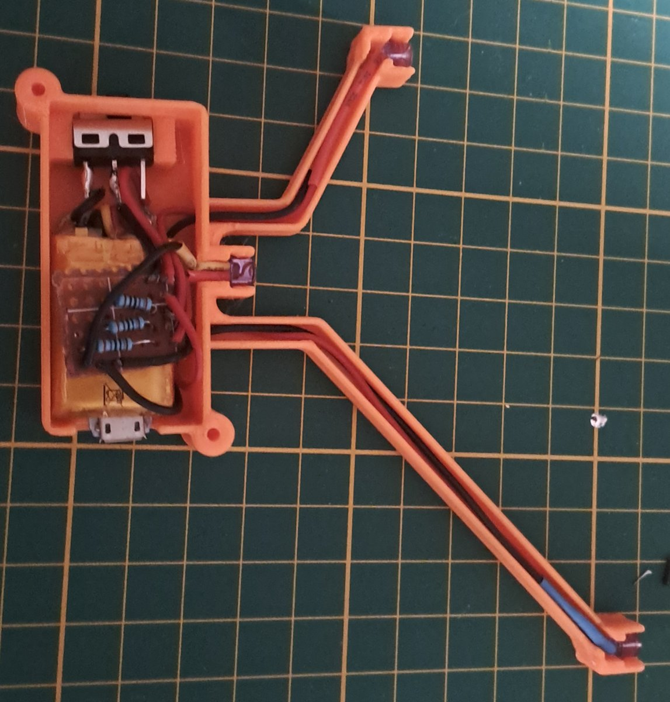
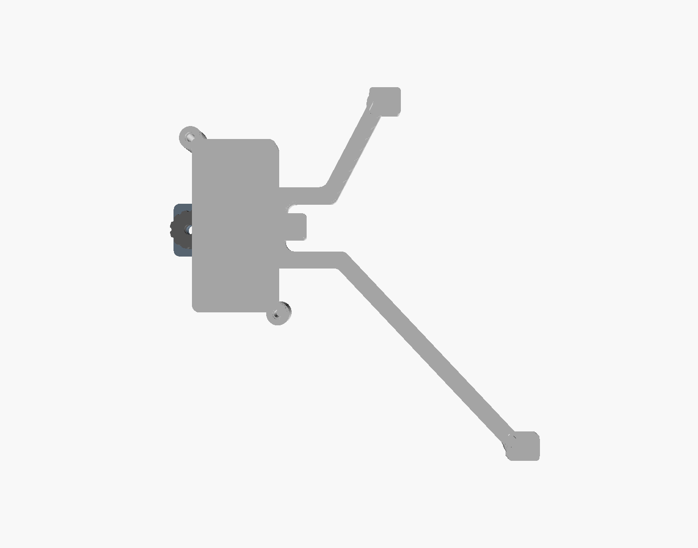
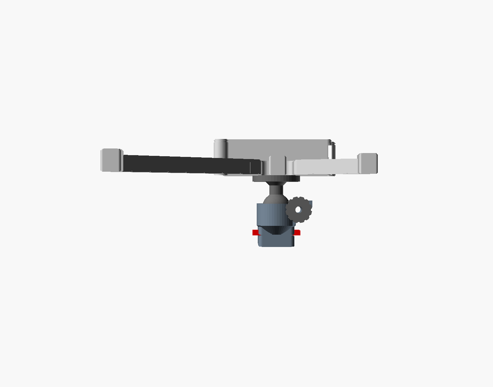

# IR Tracker

A DIY 3-LED infrared head-tracking clip for PC gaming headsets: a 3D-printed frame that holds three IR LEDs in the
TrackClip Pro geometry, powered by an on-board LiPo with USB charging and a power switch, clamped on the headset fork
and aimed with a lockable ball joint. It works with TrackIR (TrackClip Pro profile) and with
[opentrack](https://github.com/opentrack/opentrack)'s PointTracker on a webcam with its IR-cut filter removed.

Designed for the **HyperX Cloud II Wireless** (left fork). Every dimension is a parameter in one OpenSCAD file, so you
can adapt it to another headset or battery.



The built clip, lid and channel covers off: switch at the top of the box, perfboard junction with the three
resistors on top of the battery, micro-USB at the bottom, LED wires in the channels.



| Side view (front to the right) | Seen from the camera |
|---|---|
|  |  |

**Status:** built and working (October 2026). Mass budget: under 41 g with the battery.

## Features

- LED positions match the TrackClip Pro: F (0, 0), T (30, 40), B (74, −70) mm, all three pointing at the camera
  ([diagram](docs/led-geometry.svg)). `tools/check.sh` checks these positions every time you rebuild.
- Nothing of the clip inside a ±20° cone in front of any LED.
- Tool-less, non-destructive mount: a two-jaw clamp lined with electrical tape, tightened with a knurled knob.
- One ball joint (Ø14) sets pitch, yaw and roll for the whole clip, locked by a second knob. The LEDs never move
  relative to each other.
- Battery box with a slide switch and a micro-USB notch at the bottom: you can charge it, or play with the cable
  plugged in, without removing the clip.
- Wires run in covered channels in the frame. No wire hangs loose.
- Prints in PETG without supports.

## Repository

| Path | What |
|---|---|
| `ir-tracker.scad` | The parametric model (all parts) |
| `ir-tracker.3mf` | OrcaSlicer project, all 12 parts on one plate, PETG 0.2 mm |
| `tools/check.sh` | Renders every part; fails on any assert, a wrong LED position, an LED field-of-view intrusion or the mass budget |
| `tools/build.sh` | Re-exports every part into the 3MF (keeps plate layout and settings) and redraws `renders/` |
| `docs/design.md` | Design notes: requirements, decisions, prototype history, tuning checklist |
| `docs/led-geometry.svg` | LED positions |

Requirements: [OpenSCAD](https://openscad.org/) 2021.01 or later, Python 3 (for the checks and the 3MF refresh),
[OrcaSlicer](https://github.com/SoftFever/OrcaSlicer) or any slicer that reads 3MF.

## Bill of materials

| Qty | Part | Notes |
|---|---|---|
| 3 | IR LED, 940 nm, 5 × 5 mm square body with a 5.75 mm flange | Wide angle; other sizes: `led_body`, `led_flange`, `led_h` |
| 3 | Resistor 270 Ω 1 %, 1/4 W | One per LED, ~9 mA each at 3.7 V |
| 1 | LiPo cell + charger board with micro-USB, as one block | Prototype: 240 mAh, 40 × 20 × 10 mm (from a bike lamp), ~8 h of use |
| 1 | Slide switch SS12D00G4 (1P2T) | |
| 1 | Small piece of perfboard | Junction for the LED branches and resistors |
| 2 | M3 round-head screw (Ø 5.4 head): 16 mm (clamp), 18 mm (socket pinch) | Glued into the knobs |
| 2 | M3 nut | Clamp inner jaw, socket pinch lug |
| 3 | M3 × 6 round-head screw | Ball flange into the box floor (self-tapping) |
| 2 | M3 × 6 self-tapping screw | Lid |
| | 28 AWG wire, heat-shrink, PVC electrical tape, hot glue | |

## Adapting the battery box

The box is built around the battery pack. **All the dimensions you need to measure are in the
`/* [Your parts] */` section at the top of `ir-tracker.scad`:**

```openscad
pack = [40, 20, 10];          // length (vertical, USB end down), width, thickness, mm
pack_clr = 0.4;               // clearance around the pack
pack_top_room = 3;            // room above the pack for wires and the junction board
sw_zone = 10;                 // room above the pack for the slide switch
lane = 3.5;                   // wire lane along the wall on the F LED side
usb_zc = 3;                   // micro-USB centre above the pack bottom
usb_window = [13, 8.5];       // notch for the plug
box_dy = 0;                   // box height relative to the F LED
```

The cavity, lid, screw bosses, switch pocket and USB notch all follow from these. Measure the pack **with its
wires and any protruding solder joints**, add the junction board to `pack_top_room` if it sits on top of the pack,
then run `tools/check.sh`. It refuses parameters that would put the box in an LED's field of view, run the USB notch
into a wire entry, or exceed the mass budget. The values are also exposed in the OpenSCAD Customizer.

For another headset, see `/* [Fork and clamp] */` (fork section, free space behind it, clamp length) and the tuning
table in [docs/design.md](docs/design.md#first-fit-checklist).

## Printing

All parts in PETG, 0.2 mm layers (0.12 mm is better for the ball and socket), 15 % infill, no supports. Open
`ir-tracker.3mf` in OrcaSlicer: the plate is ready, with 0.43 mm wall lines. Thin walls in the model are whole numbers
of these lines (`walls(n)` in the SCAD). If your slicer uses a different line width, change `line_w`.

| Part | Qty | Orientation |
|---|---|---|
| Arm + LED bosses + battery box | 1 | Inner face down, LED slots and box open upwards |
| Wire-channel covers (F + T run, B run) | 1 + 1 | Flat |
| Box lid | 1 | Outer face down |
| LED caps (F, T, B) | 3 | Flat |
| Clamp outer jaw + ball socket | 1 | Fork channel down |
| Clamp inner jaw | 1 | Flat |
| Ball + stem + flange | 1 | Flange down |
| Knob | 2 | Flat |

To export a single part as STL: `openscad -D 'part="print_arm"' -o arm.stl ir-tracker.scad` (parts: `print_arm`,
`print_cover_ft`, `print_cover_b`, `print_lid`, `print_led_cap_F` / `_T` / `_B`, `print_clamp_outer`,
`print_clamp_inner`, `print_ball`, `print_knob`).

## Assembly

Wiring: pack + → switch (middle pin + one side pin) → junction board → three branches in parallel, each
270 Ω + LED → pack −. The order below is the one used for the working build.

1. **Fit the clamp on the headset.** Put one layer of electrical tape on each jaw, press a nut into the inner jaw and
   glue the screw heads into the two knobs. Place the inner jaw behind the fork (towards the earcup), ridge at the
   back, fit the outer jaw over the fork and screw the knob in from outside.
2. **Build the junction board.** On a small piece of perfboard, solder the base wires to the pack, the switch, the
   three 270 Ω resistors, then one "long" pair of wires per LED. **Leave the F (middle) LED wires 6 cm or more**: F
   sits right against the box and is very hard to reach once it is in its slot. The resistors cannot go on the LED
   legs: the legs bend straight down into the wire channel right behind the flange, with no room for a resistor.
3. **Solder the LEDs.** Solder each LED to its pair of wires and protect the legs with heat-shrink. Drop each LED
   into its slot from outside, emitting face towards the front (the T / B side, towards the camera), flange towards
   the back, legs bent down into the wire channel. Press the cap on top.
4. **Route the wires.** F runs straight back into the box through the open trench (the lid closes it). T and B run
   down their branch and into the box through the slots at the foot of the inner wall.
5. **Wire the box and mount the ball.** Press the switch into its pocket against the top wall, lever through the
   slot. Hot-glue the pack on the floor bosses, with the micro-USB in front of its notch, and tuck the junction board
   on top of the pack (reserve room for it with `pack_top_room`; see the photo above). Fix the ball flange to the outside of the box floor with
   3 × M3 × 6 driven **from the ball side** (they self-tap into the floor bosses). There is no room inside the box
   for the screw heads. Close the lid with 2 × M3 self-tapping screws.
6. **Close the channels.** Fit the two channel covers in their recesses and fix them with hot glue.
7. **Mount it.** Snap the ball into the socket, put the nut in the pinch lug, then fit the screw and the second knob.
8. **Aim it.** In TrackIR (TrackClip Pro profile) or opentrack, loosen the pinch knob, aim the clip so all three
   points are visible and upright, then tighten the knob.

## Results

With opentrack (PointTracker) and a webcam modded for IR (IR-cut filter removed, IR-pass filter added), each LED
shows as a spot about 12 px wide, even at 2 m from the camera.

## Build notes

- The battery block came out thicker than planned. The ball flange screws now go in from the ball side into 1 mm
  bosses on the box floor, so they no longer take room under the pack.
- A small perfboard for the base wires, switch, resistors and LED branches made the wiring much tidier than
  splicing in the lane.
- The resistors cannot sit on the LED legs: the legs bend down to follow the printed slot immediately behind the
  flange. They go on the junction board instead.
- The middle LED (F) is the hardest to place: its wires are short and the box is right behind it. Leave its wires
  long.
- The channel covers were hot-glued rather than relying on their press fit.

## License

© 2026 Aurélien Labrosse. Licensed under
[Creative Commons Attribution-NonCommercial-ShareAlike 4.0](https://creativecommons.org/licenses/by-nc-sa/4.0/)
([LICENSE](LICENSE)): you may print, modify and share it with attribution, not for commercial use, and remixes must
use the same license.

## Credits and disclaimer

TrackIR and TrackClip are trademarks of NaturalPoint, Inc. HyperX is a trademark of HP Inc. This project is not
affiliated with or endorsed by either company. The LED layout reproduces the publicly known TrackClip Pro geometry so
that existing tracking software recognises it.

LiPo cells can catch fire if shorted, punctured or charged without protection. Use a pack with a protection circuit
and a proper charger board.
